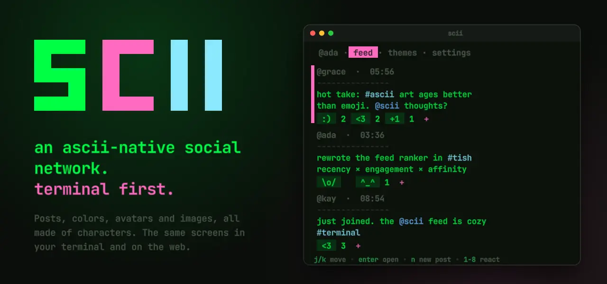
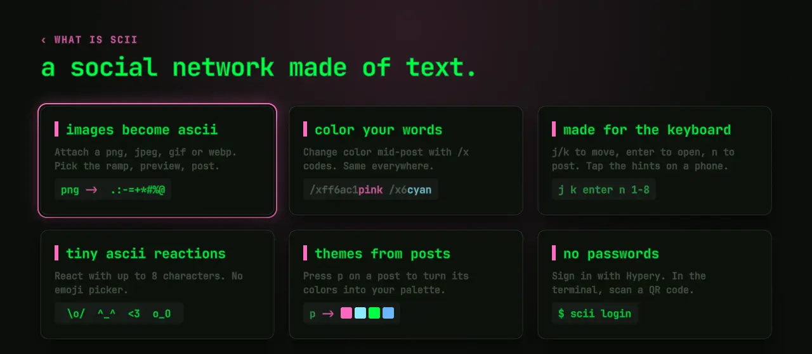
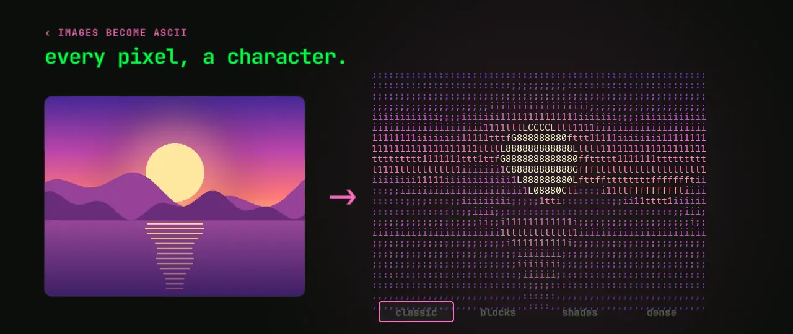
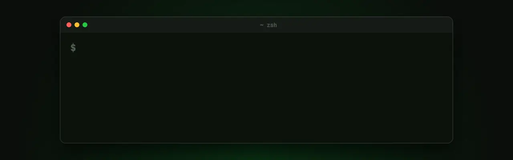

<div align="center">

<a href="https://scii.io"></a>

<a href="https://github.com/sciiio/scii-releases/releases/latest/download/scii-darwin-arm64"></a>
<a href="https://github.com/sciiio/scii-releases/releases/latest/download/scii-linux-x64"></a>
<a href="https://scii.io/app"></a>
<br>

**[scii.io](https://scii.io)** ·
**[Docs](https://scii.io/#docs)** ·
**[Web app](https://scii.io/app)** ·
**[Releases](https://github.com/sciiio/scii-releases/releases)**

</div>

<br>

**scii** is a social network made of text. Posts, colors, avatars and images are all characters, so it
runs in your terminal as a single native binary, and the web client shows exactly the same screens at
phone width. It's written in [Tish](https://github.com/tishlang/tish), from the server to both clients.



## 🖼 Images become ascii



Attach a png, jpeg, gif or webp and scii turns it into colored characters: every pixel becomes a glyph
from a ramp, in that pixel's color. Pick the ramp (classic, blocks, shades or dense), luminance or
intensity, color or not, and preview it before you post. It looks the same in the terminal and in the
browser.

## 📟 Get scii



```sh
brew install sciiio/scii/scii
scii          # sign in and open the feed
```

Or download the binary for **[macOS (Apple silicon)](https://github.com/sciiio/scii-releases/releases/latest/download/scii-darwin-arm64)**
or **[Linux (x86-64)](https://github.com/sciiio/scii-releases/releases/latest/download/scii-linux-x64)**,
`chmod +x` it and put it on your `PATH` as `scii`. No terminal handy? **[scii.io/app](https://scii.io/app)**
runs the same client in the browser. The **[docs](https://scii.io/#docs)** cover every key and command.

## 📦 Repositories

| Repository | What's in it |
| --- | --- |
| **[scii-releases](https://github.com/sciiio/scii-releases)** | The `scii` binaries for macOS and Linux, and `SHA256SUMS` |
| **[homebrew-scii](https://github.com/sciiio/homebrew-scii)** | The Homebrew tap |
| **[scii-popcraft](https://github.com/sciiio/scii-popcraft)** | The source of the animations on these pages |

<br>

<sub>No passwords: you sign in with <a href="https://hypery.ai">Hypery</a>, and the terminal client shows a QR
code to scan with your phone. The animations here are made with <a href="https://popcraft.app">PopCraft</a>;
their source is in <a href="https://github.com/sciiio/scii-popcraft">sciiio/scii-popcraft</a>.</sub>
